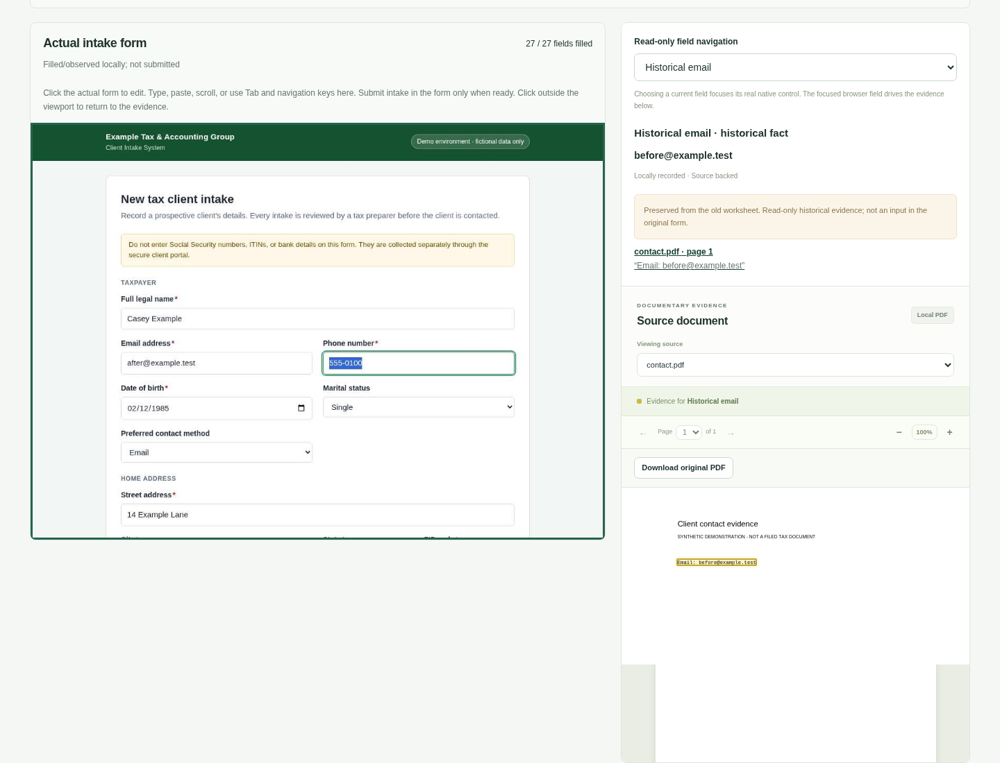

# Tax Document Intake and Review

Upload selectable-text PDFs and UTF-8 text files, identify client/year groups with Gemini, and fill the original `intake_form/index.html` through Playwright while reviewing its source evidence alongside.

The controller, storage, and browser workers run locally. The intake website runs on a separate HTTP origin and is treated as an external website: ordinary browser interaction only. Gemini is an external service; TaxSlayer is not connected. The original email-intake CLI remains available in `main.py`.

> Bundled examples are fictional. The workspace starts empty and stores only information and files you explicitly add. Use approved synthetic/redacted documents; live taxpayer data must not be sent to external AI under the current agreement.

## Local review workspace

The workspace uses **React/TypeScript + TanStack Router + Vite, Tailwind CSS, shadcn/ui, Bun, FastAPI, SQLite, PDF.js, Google Gen AI, and Playwright**. Drag-and-drop intake uses react-dropzone and supports mixed clients and years. Gemini returns normalized client/year drafts using the original intake model; originals remain available for preparer review.

The review page combines grouped editable fields, documentary evidence, and a **view-only image of the actual Chromium browser**. Local typing does not send individual keystrokes to Playwright. Applying a field sends its complete value through the original website's native controls and confirms the result by browser readback. There is no injected target script or target-API shortcut. The unchanged intake website is the TaxSlayer stand-in.



From the project root, with an activated Python environment and Bun 1.4.4:

```bash
pip install -r review-requirements.txt
python -m playwright install chromium
(cd review_ui && bun install --frozen-lockfile && bun run build)
python review.py
```

Create a project-root `.env` file (gitignored), then restart the service:

```dotenv
GEMINI_API_KEY=your-key
GEMINI_MODEL=gemini-3.5-flash-lite
```

Get the key from [Google AI Studio](https://aistudio.google.com/api-keys). The selected model has a [free tier](https://ai.google.dev/gemini-api/docs/pricing#gemini-3.5-flash-lite), subject to project eligibility and quota; paid projects can incur charges. Free-tier content may be used for product improvement. Extraction requires explicit confirmation that the files are approved synthetic/redacted documents. Keys stay in the local environment, never in browser settings or SQLite.

One launcher starts the companion at `http://127.0.0.1:8765` and independently serves the unchanged `intake_form/index.html` on another loopback port. Both URLs are printed. `--no-browser` suppresses opening the dashboard; `--show-workers` shows native Chromium windows. To use an already-running stand-in, pass `--intake-url http://127.0.0.1:PORT/index.html`. The default automation limit is two; `--workers` changes the configured limit, not the hardware's proven capacity. **Current process supervision is Linux-only.**

The launcher serves only the compiled frontend. Vite is a build tool, not a separate application server. After frontend source changes, run `(cd review_ui && bun run build)`, restart `python review.py`, and refresh the dashboard.

SQLite stores original documents, candidates, review history, jobs, locally observed browser values, and observed receipt IDs in `outputs/review_workspace/`. Use `--data-dir` and `--port` for another workspace. **The stand-in's submitted records are in memory only; it has no Save Draft.** Closing the dashboard leaves the local service and retained browsers running. Stopping the service closes its browsers. Rebuild before launching, and restart the service after rebuilding.

Startup creates an empty schema; it never inserts clients, example values, or PDFs. Clearing the database stays cleared after restart. Stop the service before manually clearing or replacing its database. Existing records, including earlier example records, are preserved until explicitly removed; this update does not purge them. Generated examples now live only in test fixtures.

**Document inbox:** Drop multiple selectable-text PDFs or UTF-8 `.txt` files anywhere in the main Clients workspace, including outside the inbox card, or use **Select files**. No client setup is required first. Files are limited to 10 MiB; scans/photos/OCR remain unsupported. Uploading saves and validates readable text locally; it does not send documents to Gemini. The upload bar shows file-level progress, and extraction uses an indeterminate bar because the model does not report a completion percentage. Each file shows its saved, processing, failed, or extracted status.

To identify clients and extract structured values, configure GEMINI_API_KEY, approve the external-data transfer, and choose **Extract uploaded documents**. The message above the button explains any unmet requirement. Upload, extraction, and assignment failures remain visible per file; other files continue. Retry failed files explicitly. An API key is required for Gemini extraction, not for local upload or PDF/TXT text validation.

Gemini receives a JSON Schema through `response_json_schema`. Each detected client/year record uses the original `IntakeExtraction` normalization and `form_values()` mapping, including dates, state codes, choices, income categories, urgency, and summaries. Invalid structured records receive one validation-feedback retry. Generation omits bounds that make the provider grammar unacceptable; the application still validates the original model. Provider failures report an HTTP status and fixed guidance without exposing raw error payloads or credentials.

**AI drafts and source locations:** Extraction does not require literal answer matches, non-overlapping source lines, or taxpayer identifiers. Multiple clients or requested tax years may share source paragraphs. Imported answers remain AI-extracted drafts pending preparer review. Local source matching adds exact quotes and PDF regions or TXT lines when an unambiguous location is available, including normalized dates such as a prose birth date. Existing saved drafts gain available locations without another Gemini request. A location is not independent verification of the answer; inferred summaries and ambiguous matches retain document context without manufactured highlights. Conflicting values and preparer edits are preserved.

Shared client identity/contact details can be cited across multiple requested years when the document identifies that client and does not scope the line to another year. Year-specific and ambiguously attributed values still require a matching scope. This also applies to previously uploaded documents without re-extraction.

Clicking or tabbing into an editable field immediately selects its evidence without moving input focus or applying the value. Fields without a citation show an explicit message; changing fields clears the previous highlight while preserving local edits.

The intake preview defaults to **Fit width** so the full form width is visible without horizontal scrolling. **Preview zoom** offers 50%, 75%, 100%, and 125% of the original image size for closer inspection; changing preview zoom does not change the destination form or its values.

For temporary diagnostics, start the backend with raw-response logging:

```bash
GEMINI_DEBUG=1 uv run --no-project --with-requirements review-requirements.txt python review.py
```

Gemini's generated JSON appears in the backend terminal before record validation, inside a JSON-escaped `response` log field. It can contain document-derived personal information: use approved sample/redacted documents, redact logs before sharing, and leave `GEMINI_DEBUG` unset normally. Extraction-only changes need a backend restart, not a frontend rebuild. This AI-draft UI update has already been built; restart the backend and reopen older tabs to load it.

Each detected client/year gets its own workspace and preparation session. A unique normalized client name can match across files and years when provided email and birth-date details do not conflict; ambiguous names or conflicting details require a choice instead of a silent merge. Missing client name, year, or return type can be assigned inline. No SSN is required. The same client's different years share a client profile but keep separate returns and browser sessions.

**One-page review:** Edit all supported fields in grouped sections beside the original form preview and source evidence. Typing stays local; **Apply** sends a complete value through Playwright and records preparer provenance only after successful native readback. Local drafts survive background polling. **Use in form** applies a document candidate and records its source decision after readback. Reasons are optional. Selecting evidence never accepts a proposal automatically. The preview is view-only: its full-page image scrolls locally without queued wheel commands. Smooth scrolling targets at least 30 FPS; image refresh frequency and end-to-end command latency are separate measurements, and a 34 ms maximum latency is not guaranteed.

After an extraction batch finishes, the backend automatically queues the assigned client/year returns using their latest saved revisions. Real Playwright opens the original `index.html`, fills normalized AI drafts and preparer values, verifies native control readback, and hands off **before submission**. Worker/session capacity governs when each queued browser opens; existing unsent browsers are not silently replaced. **Open and fill form** remains available for explicitly opening/reopening a return. Watch the preview or use `--show-workers` to interact directly with the native window. Explicitly confirm **Submit intake** in the dashboard to have Playwright click the original website's submit button; its native validation and confirmation remain authoritative. The worker still uses the original form's known field mapping; it is not a generic adaptive browser agent or a TaxSlayer connection.

Handoff releases the automation slot while retaining the browser. At most `max(4, workers)` sessions remain open; further jobs wait for capacity. Sessions are never silently expired or evicted. Explicitly close a retained browser before changing its source documents or opening another browser for that return. Restart preserves recorded evidence/history but cannot restore an unsent browser draft or replay a submission.

Earlier generated-worksheet runs and facts remain historical records. Wage/totals have no corresponding intake controls and stay in read-only historical facts with their citations and corrections. Compatible phone facts can be reused. Previously completed extraction under the old field contract requires renewed consent and re-extraction; its earlier groups are preserved.

**Source library** can attach PDF/TXT files to an existing return after its browser closes. Use **Extract documents** to process them; upload alone does not extract values. Originals are immutable and duplicate bytes are deduplicated. Original/corrected W-2 documents remain available as historical evidence; neither is silently discarded or mapped into an unrelated form control.

Frontend: [inbox](review_ui/src/components/intake/DocumentInbox.tsx), [combined review](review_ui/src/components/review/ReviewWorkspace.tsx), [field editors](review_ui/src/components/review/FieldEditors.tsx), [actual browser preview](review_ui/src/components/automation/BrowserSurface.tsx), [PDF viewer](review_ui/src/components/evidence/DocumentViewer.tsx), and [TXT viewer](review_ui/src/components/evidence/TextDocumentViewer.tsx). Backend: [API](src/review_api.py), [Gemini intake](src/review_intake.py), [local citations](src/review_citations.py), [store](src/review_store.py), [native field contract](src/intake_contract.py), [queue](src/review_jobs.py), and [worker](src/review_worker.py).

Development language servers are configured in `.omp/lsp.json`: the nested frontend uses its installed TypeScript server, and Pyright runs through Bun's native npm package instead of the Python launcher.

Verification:

```bash
(cd review_ui && bun run build)
python -m pytest tests/test_review_citations.py tests/test_review_intake.py tests/test_review_drafts.py tests/test_review_auto_sessions.py tests/test_review_inbox_browser.py tests/test_review_intake_api.py tests/test_review_returns.py tests/test_review_workspace.py tests/test_review_documents.py tests/test_review_jobs.py tests/test_review_prototype_api.py tests/test_review_worker_browser.py tests/test_form_server.py
```

Focused regressions cover normalized multi-client/year records, identity matching and ambiguity, validation-feedback retry, safe SDK errors/debug logging, draft provenance, preparer edits, and original/corrected-value conflicts. Actual Chromium regressions prove automatic separate sessions, owned-document AI choices, native readback, review display, and no automatic submission. Automated model tests use isolated transports; a separate live Gemini check combined the bundled Priya Nair TXT and Luis Ortega PDF and returned distinct 2025/2026 client drafts with normalized intake values. No private uploaded documents were sent during that verification. This does not establish accuracy on real returns, real TaxSlayer access, or production security approval.

The editable-review Chromium scenario verified local drafts surviving polling, whole-field email/date/select/checkbox changes, matching browser readback, source viewing, and explicitly confirmed native submission. Native preview scrolling measured 60.0 position updates/second, with a 16.7 ms p95 interval and 16.8 ms maximum in that local headless run; scrolling sent no browser-action requests. These measurements are not a hardware-independent latency guarantee. The full-page browser image refreshes approximately once per second; local scrolling runs independently at the display cadence.

The companion uses a per-launch API header token and Host/Origin checks. Its separate browser context sends no companion credentials to the intake website. It does not inject a bridge, call target JavaScript helpers, or directly submit to the target API; the original website's own submit handler performs its normal request. Real TaxSlayer requires written authorization, authorized account/environment access, and separate ProWeb/Pro Desktop adapters. Playwright does not automate native Pro Desktop. Production approval, storage/security controls, quality thresholds, and packaging remain open in the [design checklist](docs/LOCAL_COMPANION_DESIGN.md).

### Frontend structure

The frontend follows the [shadcn/ui Vite setup](https://ui.shadcn.com/docs/installation/vite). Reusable UI primitives live separately from feature components; routes load data and compose features, hooks manage stateful workflows, and `lib` contains API contracts and utilities.

```text
review_ui/src/
  components/
    ui/           Shared shadcn buttons, inputs, alerts, progress, and other primitives
    layout/       Application shell
    clients/      Saved client queue
    intake/       Document upload, consent, file status, and assignment
    review/       Review workspace and history
    evidence/     PDF and text evidence viewers
    automation/   Actual-browser surface and job controls
    routing/      Route loading and error feedback
  hooks/          Reusable workflow hooks
  lib/            API client, schemas, and shared utilities
  routes/         TanStack file routes
  index.css       Tailwind entry, shared theme tokens, and progress keyframes
```

Use Tailwind utilities and existing shared primitives rather than restoring a component stylesheet. `components.json` configures shadcn, and `@/` resolves to `src/`. Before adding a feature, inspect the package manifest and related components, check installed libraries, and consider an established dependency before writing custom behavior.

The inbox browser regression runs against a temporary workspace and replaces only the external Gemini boundary. It temporarily clears its own API-key environment to check the missing-key state; it never edits `.env`, uses live taxpayer documents, or sends a real model request.

The instructions below describe the original intake-automation demo.

Adapted from [immigration-intake-Form-Agent](https://github.com/AshwinSanthanakrishnan/immigration-intake-Form-Agent). A tax practice has no "case types", so the intake is built around the taxpayer instead: identity and photo ID, home address, tax year, filing status, dependents, income sources and deductions.

---

## The problem

A tax preparation firm gets a steady stream of inquiries, and many arrive in a rush around filing and extension deadlines. For each one, someone has to:

1. Read the email and work out what the client needs (a late return, an amended return, an IRS notice, next season's return...).
2. Retype the client's details, including their driver's license, into the firm's intake system.
3. Judge how urgent it is. An IRS notice with a response date next month can't wait in a queue.
4. Write back if anything is missing.
5. Prepare a list of documents the client should gather (W-2s, 1099s, 1098s...).

Clients also tend to paste their Social Security number or bank details straight into the email. This project automates the clerical work, keeps those numbers away from the AI, and keeps people in charge of every decision that reaches a client.

## What it does

For every file in `sample_inputs/`, the program runs these steps:

| # | Step | What happens |
|---|---|---|
| 1 | **Read** | Loads the email from a `.txt`, `.pdf`, `.eml` or `.md` file. |
| 2 | **Redact** | Masks Social Security numbers, ITINs, and bank account or routing numbers **in code, before any AI call**. The report notes which emails contained them so staff can steer those clients to a secure channel. |
| 3 | **Extract** | AI pulls out the twelve required details: name, email, phone, date of birth, street address, city, state, ZIP, driver's license number, issuing state, license expiration date, and tax year. It also sets an urgency level with a reason, and captures optional details when the client mentions them: marital status, preferred contact method, license issue date, filing status, number of dependents, occupation, employer, income sources (W-2, 1099/self-employment, interest and dividends, investment sales, rental, retirement, unemployment), deductions and credits (mortgage, charitable, education, student loans, childcare, medical, IRA/HSA, marketplace insurance), whether an IRS or state notice was received, any deadline, whether they want a consultation, and a one-line summary. The result is checked against strict rules. If the answer is invalid it retries once, then flags the record for a person. |
| 4 | **Decide** | If any required detail is missing, the record is **not submitted**. The AI drafts a polite follow-up email asking for exactly what's missing, saved for staff to review. |
| 5 | **Fill the form** | For complete records, a browser (Playwright) opens the intake form, finds each field by its label, types or checks every value, and clicks Submit. You can watch it happen. |
| 6 | **Verify** | The program checks that a confirmation and intake ID appeared **and** that the intake system stored the same details. It marks the record PASS or FAIL and saves a screenshot. |
| 7 | **Checklist** | For each accepted client, the AI drafts a document checklist from their tax profile (income sources, deductions, dependents, notices), marked as a draft for preparer review. |
| 8 | **Report** | Writes `outputs/run_report.pdf` with counts, PASS/FAIL, timings, every client's details, confirmation screenshots and next steps for staff. A Markdown copy (`run_report.md`) is saved next to it. |

One bad file never stops the run. The problem is recorded in the report and the next file is processed.

## Quick start

You need Python 3.10 or newer.

```bash
git clone https://github.com/AshwinSanthanakrishnan/tax-intake-Form-Agent.git
cd tax-intake-Form-Agent

python3 -m venv .venv
source .venv/bin/activate
pip install -r requirements.txt
playwright install chromium

cp .env.example .env
```

Open `.env` and replace `your-gemini-api-key` with your own [Google Gemini API key](https://aistudio.google.com/apikey). To use Claude instead, leave `GEMINI_API_KEY` unset and set `ANTHROPIC_API_KEY` (the default Claude model is `claude-opus-5-5`). The `.env` file is ignored by git, so your key is never uploaded.

Then run it:

```bash
python main.py
```

A browser window opens and fills in the form for each client. Results appear in the `outputs/` folder.

### No API key?

```bash
python main.py --offline
```

This replaces the AI with simple keyword rules so you can see the whole flow without a key. Everything it produces is labeled as offline output.

### Other options

| Command | What it does |
|---|---|
| `python main.py --headless` | Runs the browser invisibly. |
| `python main.py --slow-mo 800` | Slows browser actions, useful for screen recordings. |
| `python main.py --inputs my_folder` | Reads emails from a different folder. |
| `python main.py --model <name>` | Uses a different Gemini (or Claude) model. |
| `./run.sh` | Sets up the environment if needed, then runs the project. |
| `python -m pytest` | Runs the tests (no internet or API key needed; the end-to-end test uses Playwright's Chromium). |

The program exits with code `0` if every submitted record verified, and `1` if there was a verification failure or an error.

> **Free-tier note:** Gemini's free plan limits how many requests you can make per minute. With all 10 sample files the run slows down while it waits, and a record may be flagged for human review if the limit isn't lifted in time. A paid key, or running on fewer files, avoids this.

## Sample data

`sample_inputs/` contains 10 fictional inquiries; four are PDF intake questionnaires.

| File | Situation | Expected path |
|---|---|---|
| `01_w2_extension_priya_nair.txt` | W-2 employee, extended 2025 return due this week | Submitted, high urgency |
| `02_joint_return_planning_daniel_okafor.txt` | Married couple, two kids, new preparer for next season | Submitted, low urgency |
| `03_freelancer_unfiled_messy.txt` | Messy phone email, freelancer with crypto sales, no license or contact details | **Follow-up drafted** |
| `04_rideshare_estimated_tax_luis_ortega.pdf` | Rideshare driver setting up estimated payments | Submitted |
| `05_widowed_retiree_harold_jensen.txt` | Retiree with pension, Social Security and a rental; **expired license** | Submitted, flagged for a current ID |
| `06_irs_notice_cp2000_angela_brooks.pdf` | IRS CP2000 notice; the form includes an **SSN** | Submitted, SSN redacted before AI |
| `07_amend_head_of_household_jasmine_reed.txt` | Single parent wanting to amend a self-prepared return | Submitted |
| `08_relocation_rsu_planning_elena_vasquez.pdf` | Moved states mid-year, RSUs and HSA | Submitted |
| `09_rental_condo_sanjay_patel.txt` | New rental condo; emailed **bank routing and account numbers** | Submitted, bank numbers redacted |
| `10_unfiled_years_levy_notice_terrence_walker.pdf` | Two unfiled years and an IRS levy notice; license "at appointment" | **Follow-up drafted** |

## What you get

After a run, the `outputs/` folder contains:

| Path | Contents |
|---|---|
| `run_report.pdf` | The summary of the whole run. Start here. |
| `run_report.md` | The same report as Markdown. |
| `screenshots/` | A screenshot of each confirmation page. |
| `followups/` | Draft replies to clients with missing information. |
| `checklists/` | Draft document checklists, one per accepted client. |
| `needs_review/` | Records the AI couldn't process reliably, for a person to handle. |
| `logs/` | A detailed log of each run. |

Example from an offline run on the sample files:

| Source | Client | Tax year | Urgency | Outcome | Verification |
|---|---|---|---|---|---|
| 01_w2_extension_priya_nair.txt | Priya Nair | 2025 | High | Submitted | PASS |
| 02_joint_return_planning_daniel_okafor.txt | Daniel Okafor | 2026 | Low | Submitted | PASS |
| 03_freelancer_unfiled_messy.txt | Marcus Bell | 2025 | High | Follow-up drafted | n/a |
| 06_irs_notice_cp2000_angela_brooks.pdf | Angela Brooks | 2024 | High | Submitted | PASS |
| 10_unfiled_years_levy_notice_terrence_walker.pdf | Terrence Walker | 2024 | High | Follow-up drafted | n/a |

| The form, filled in by the browser | The verified confirmation |
|---|---|
|  |  |

## How the code is organized

| File | Job |
|---|---|
| `main.py` | The single command that runs everything. |
| `src/input_reader.py` | Finds and reads the email files, including PDFs. |
| `src/redaction.py` | Masks SSNs, ITINs and bank numbers before anything reaches the AI. |
| `src/ai_client.py` | Talks to the AI and holds the instructions it is given. |
| `src/extraction.py` | Checks the AI's answer and retries once if it's invalid. |
| `src/models.py` | Defines what a valid intake record looks like, and the form's field labels. |
| `src/form_server.py` | The local stand-in for the firm's intake system. |
| `src/form_filler.py` | The browser automation that fills in and submits the form. |
| `src/verification.py` | Confirms each submission landed and takes the screenshot. |
| `src/drafts.py` | Saves follow-up emails and checklists with review banners. |
| `src/reporting.py` | Builds the run report (Markdown). |
| `src/report_pdf.py` | Renders the run report as a PDF. |
| `src/pipeline.py` | Runs the steps above for each file. |
| `src/offline_ai.py` | The keyword-rule stand-in used by `--offline`. |
| `intake_form/index.html` | The demo intake form. |
| `tests/` | Automated tests, including an end-to-end browser test. |

### Pointing it at your firm's own form

The form filler finds every field by its visible label (`FORM_FIELDS` in `src/models.py`) and selects checkboxes by their label text. To use a different intake form, change those labels to match it, and change `run_pipeline` in `src/pipeline.py` to open that form's URL instead of starting the local demo server.

## Privacy and safety

- **Fictional data only.** Every person, address, email, phone number and ID number in the project is made up, and so is the firm named on the form.
- **No real websites.** The browser only visits the practice form served from your own computer. The only outside connection is to the AI provider.
- **SSNs and bank details never reach the AI.** Social Security numbers, ITINs, and bank account and routing numbers are masked in code before extraction or drafting. The prompts also tell the model never to extract them. Follow-up emails never ask for them.
- **ID numbers are masked in output.** The driver's license number is a required intake field, so it is sent to the AI and entered on the form. The confirmation page, run report, PDF and logs show only its last four characters.
- **Humans stay in control.** Nothing is ever sent to a client. Follow-ups are saved as drafts marked `DRAFT - NOT SENT`, and checklists are marked `DRAFT FOR PREPARER REVIEW. NOT TAX ADVICE.` The program adds these labels itself, so the AI can't leave them out.
- **Incomplete means not submitted.** A record with missing details is never entered into the system. The program, not the AI, decides what counts as missing.
- **Share as little as possible.** The checklist step sends the AI only the tax profile (tax year, state, filing status, dependents count, income and deduction categories), never the client's name, contact details, address, date of birth or ID numbers.
- **Secrets stay local.** Your API key lives in `.env`, which git ignores, and is never logged. The `outputs/` folder is also ignored, because in real use it would hold client information.
- **In production,** the form filler would point at the firm's real intake system instead of the local practice form. It would also need access controls, audit logging, a retention policy for stored data, a review of how the AI provider handles taxpayer information, and compliance with the firm's IRS Publication 4557 / FTC Safeguards Rule security plan.
