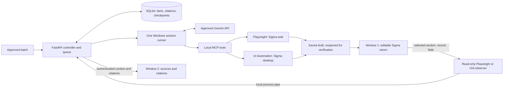

# Implement automatic Sigma draft preparation and two-window evidence review

> This is the original proposal. The operating decision changed: committed files trigger independently, and preparation and ownership are scoped to a verified return, not a completed drop. The retired prototype is not a production fallback. See [current companion setup and checks](README.md#local-review-workspace).

## Context

The deliverable is a preparer-reviewed draft in the firm's actual tax software. A completed drag-and-drop batch starts work without a preparer prompt. A worker prepares and verifies the saved draft, releases write access, and hands off to a preparer using two independent windows: the editable Sigma return and its original documents with field-level citations. No signing, filing, transmitting a return, or amending it; no simultaneous human/agent editing.

## Integration baseline

`README.md` and `docs/LOCAL_COMPANION_DESIGN.md` describe an existing React/TanStack, FastAPI, SQLite and Playwright companion. It already accepts mixed-client selectable-text PDFs and UTF-8 TXT, groups by client/year, acquires explicit consent for external extraction, highlights sources, and queues local intake-form sessions. Today it fills a flat intake website with no Save Draft, retains a browser, and presents a screenshot and editable controls on the dashboard. These paths are not Sigma support. `review-requirements.txt` includes `google-genai`, Playwright, pdfplumber and Pydantic. `docs/LOCAL_API_AUTHENTICATION.md` establishes a per-launch loopback header token, not person authentication or encrypted storage. Verify routing and save behavior against the firm's licensed Sigma Tax Pro edition and tax year.

## Confirmed operating choices

For the initial proof, use one approved interactive Windows session for overnight preparation and subsequent review. Run Sigma Tax Pro Desktop on a dedicated firm-managed local Windows machine unless Sigma and the firm approve the exact licensed build for unattended use on a cloud Windows VM and it passes the practice test below. If the VM is unsupported or fails that test, run the desktop worker locally; an independently approved central upload queue can stay in the cloud.

Prove an individual web return first: two employers’ W‑2s plus self-employment from rideshare work (Uber/Lyft-style records). Then prove a Windows desktop 1120 case with a nested schedule and repeating expense rows. Open an existing draft or create a new one automatically **only** when client identity, tax year, return type, and the presence or absence of that draft can be established through the authorized interface. An error or incomplete search is not “no return found.”

Traceability is a release requirement. Aim for the exact passage or box behind every documentary entry; identify the verified page when the exact region is unavailable. If only the document is identifiable, make the original available, flag the exception and leave the destination untouched pending review. Never invent a page or highlight.



This is an implementation plan only. **Unverified — confirm first:** the firm's authenticated Sigma builds, licensing for unattended access, ability to prove a draft is absent, save/reopen behavior, and what the desktop exposes through accessibility. Those checks determine which profiles may be enabled. Passing tests against a fixture does not establish Sigma compatibility.

## Approach

### 1. Obtain the two target profiles while building the first agent slice

Have the firm's preparer walk one **synthetic** case through each licensed product. Record the exact web origin, installed desktop product/build per tax year, approved practice tenant, allowed return types, navigation, identity indicators, record keys, draft creation/search, edit locks, safe Save/Close and Reopen operations, and field-focus signals. Obtain written authorization covering unattended UI access, the worker account, document processing and any screen capture. The supplied [Sigma web sign-in](https://stp.cloudtaxoffice.com/) and [Sigma product comparison](https://sigmataxpro.com/professional-tax-software-comparison-chart/) do not identify the firm's licensed screens or prove automation rights.

Capture those results in versioned connector profiles and a preparer-checked coverage sheet: source form/box or ledger field → destination section/record/field, input format, dependencies, authoritative save check, and prohibited actions. Unknown versions or form families are disabled. Use firm-approved mappings for Schedule C and 1120 schedules; do not infer treatment, elect a mileage method, or calculate the tax return. The first cases define proofs, not the whole six-week engagement or a promise to cover every 1099, state or business schedule.

Start the private agent modules and tests immediately using synthetic facts and a **test-only** persistent target with a sidebar, nested dialog, repeating rows and draft reopen. Do not build a second product UI to resemble Sigma, substitute the old intake form for a connector, or wait for the upstream upload database. If test access is unavailable, deliver and label the local mechanics results separately; do not enable that real profile or claim its acceptance.

### 2. Implement one reasoning loop and two constrained tool backends

Use the installed Python Google Gen AI SDK for an application-owned **observe → propose one action → validate → perform → read back** loop (`src/preparation/agent.py`, new). Gemini proposes the next section, row or field based on the current screen and assigned facts. The controller, not the model, starts jobs, grants capabilities, journals mutations, and decides when a return is ready. No interactive OMP/Codex/Claude session, plugin, or preparer prompt. Keep extraction (`GEMINI_MODEL`) and tool reasoning (`GEMINI_AGENT_MODEL`, explicit) independently configurable; require an approved account/model with tested function calling and, if enabled, image support. No silent switch of model, provider or data policy.

Implement the local tool host in `src/preparation/tools.py` with the Python MCP SDK over child-process **stdio**, with Playwright and Windows UI Automation backends. No public MCP listener, general browser/desktop MCP, or custom agent framework. The runner validates [Gemini function calls](https://ai.google.dev/gemini-api/docs/function-calling) explicitly before dispatch; do not enable an SDK mode that executes arbitrary proposed calls. Bind the host to one job, profile, owner generation and verified target at a time. Use the same typed contract in both backends:

- `observe()` returns the permitted section/dialog, verified identity, record context, current values and available control references with an `observationId`. Use `open_section(observationId, controlRef)`, `open_detail(observationId, controlRef)`, `list_records(observationId, listRef)`, `ensure_record(observationId, listRef, sourceRecordId)`, `set_field(observationId, controlRef, bindingId, factIds)` and `save_draft(observationId, scopeRef)`. The controller supplies only the approved facts for the assignment; the host resolves/formats the value locally. No model-invented dollar amounts. Re-observe after navigation, a conditional answer or subform save. A stale or ambiguous reference cannot act.
- Draft lookup/create and final reopen are controlled host operations. Before and after transitions verify profile, client, year, return type and, once known, the external draft key. Require a bounded, complete unique search with firm-approved identity attributes; name alone is insufficient. Never open a filed return for amendment. If a new draft is appropriate, record intent **before** Create, check the new identity and persist its durable reopen key. If preparation requires a separate unapproved client setup, file-server access, authentication or MFA, stop with the exact human action needed.
- Inspect existing rows before any append. Match by a verified external row key or unique business identity (issuer/payee, activity, account/reference, tax year and form instance as applicable), never display label, row position, or amount alone. After Save, re-enumerate and bind the saved row. Preserve two distinct documented expenses even if they have the same amount. Never delete unmatched native entries or overwrite a different, unexplained or preparer-owned value.
- The access policy runs outside the prompt: release only known draft actions on the active profile, limit model requests/steps, elapsed time and spend to configured ceilings, stop repeated no-progress actions, and treat all document and screen text as untrusted data. No shell, arbitrary scripts/URLs/shortcuts, generic “click anything,” direct Sigma DB/API/file writes, signing, e-filing, transmitting or amending. Validate redirects, popups, modal actions and foreground window as well as the original target. Block unrecognized or unsafe screens with an actionable issue.
- Before calling Gemini, strip unrelated rows, credentials, taxpayer identifiers and other clients' values from tool observations; use opaque job-local references. If a practice screen cannot be isolated safely, keep it local and block model-based interpretation. Launch the tool host with an explicit environment allowlist so it does not inherit the controller's provider key. Store no model reasoning transcript or raw screen recording.

### 3. Persist tax facts and citations independently of the target UI

Keep `ReviewStore`, its SQLite transactions, immutable original bytes, per-return document access, revisions and history. Replace the flat `IntakeExtraction`/`form_values()` mapping inside `src/review_intake.py::validate_extraction` with a versioned Pydantic tax-extraction contract (`src/preparation/contracts.py`, new). Keep the legacy email-intake CLI independent. Convert validated multi-client/year groups into repeated source records: W‑2 per employer/form; 1099 by actual subtype/payer; platform annual summary by activity/period; individually identified receipts or expenses; business financial statements and preparer-approved schedule inputs. Unknown or unreadable documents remain in the inbox with a reason. Missing, zero, false and not applicable must remain distinct. Use decimal amounts, not binary floating point.

The existing `review_returns.payload` holds flat fields; local group matching may reuse a name where email/DOB do not conflict. Keep local association/ambiguity handling but never use it as permission to select a Sigma return. Extend the store additively, using separate records with these identities and responsibilities:

Add `tax_records`, `tax_facts` (one row per candidate, validated citation list including document version), and `tax_bindings` (linked fact IDs and last verified destination state) to the existing SQLite workspace. Store reviewer decisions as append-only, revision-bound events; never change an extracted value in place to match Sigma. Enforce return membership when joining records, facts, bindings and document IDs; the source BLOB already belongs to the immutable document store. Keep per-action history in the job journal, not a second mirror of the return.

Use `(returnId, recordId, factKey)` to group alternate candidates for the **same** factual question. Preserve separate source occurrences with immutable document version and source anchor; resolve original/corrected versions against their logical record, never by upload order. Use one assigned destination per return: zero or multiple eligible profiles require assignment, not parallel writes to both products. A new input revision invalidates the current package's old ready/reviewed status; retain the older history.

| Persist | Required distinction |
|---|---|
| Source record, candidate fact and citation | A logical form/activity/line-item ID is distinct from its immutable document version and source instance. A fact has a semantic field key, raw and normalized values, provenance, and one or more return-scoped source links. Keep alternate/corrected candidates instead of replacing history. |
| Destination binding | Key by local return, versioned profile, verified external draft, section/subform, stable record identity and semantic field. Link to candidate IDs, including multiple inputs to a derived value. Store the mapping actually used, not every possible control, a permanent DOM handle or screen coordinate. |
| Observation and reviewer decision | Keep what the source says, what was proposed/entered, what was merely visible, what was verified **after reopening**, and any later human choice/correction separately. Include revision and time. A screenshot isn't documentary evidence or proof of a save. Corrections may refer to the original for comparison without claiming it proves the correction. |

At extraction, supply bounded, numbered source pages/lines and require a source reference per documentary candidate. Validate ownership, version, client/year, issuer and financial box/column/row as well as quote contents. Reuse `source_pages`, `literal_citation` and `extract_region` in `src/review_documents.py`; derive geometry from the original, never model-supplied coordinates. Restrict `match_citation` to the fact's scope. Persist validated citations with the candidates used for preparation, instead of relying on `ReviewStore._presentation_citations` to guess a location later. Preserve exact quotes even when the displayed date or amount is normalized. For two equal amounts on the page, a text match alone is insufficient.

Use an explicit evidence precision in Python and `review_ui/src/lib/apiSchemas.ts`: `region` (PDF page + normalized rectangle + literal text), `lines` (TXT line range + quote), `page` (verified PDF page, no claimed highlight), or `document` (original only, flagged). Never synthesize page 1 or a full-page rectangle to satisfy the existing required `page`/`rect` schema. Show all supporting inputs for a calculation, its derivation and the fact that Sigma performed the tax calculation; do not fabricate a source line for its result. An unsupported amount, unassigned source, unresolved conflict or document-only citation stays out of unattended entry; unrelated supported fields may still be saved.

For rideshare, associate each 1099-K/1099-NEC **when actually supplied**, platform summary, fee line and receipt with its payer, activity, period and source. Reconcile overlapping reports: a summary that corroborates gross fares is a second citation, not additional receipts; a bank payout is not automatically gross income. Do not assume a bonus is separate or that two same-amount rows are duplicates. If approved mapping and source records cannot reconcile gross, fees, incentives or expenses, preserve alternatives for the preparer. For the 1120 case, require the corporation's own statement/ledger and the agreed schedule mapping; individual W‑2/1099 data is not a substitute.

Use a versioned, transactional SQLite migration after obtaining exclusive workspace access and an approved local backup. Preserve prior originals, `review_returns` history/legacy fields, `review_intake_identities`, jobs and intake receipts as historical data. Never relabel a stand-in receipt or saved browser observation as a Sigma draft. Distinguish extraction eligibility by document digest **and contract version**; old `completed` rows require fresh authorization and new extraction, never automatic replay. On migration failure roll back and do not start workers. Do not inspect or migrate the developer's actual `outputs/` as a test.

### 4. Start automatically, own the workstation, and recover safely

Keep `useDocumentInbox` and server-side file validation (selectable-text PDF and UTF‑8 TXT, current size limits); scans/photos with no usable text need attention, not guessed OCR. Give each drop a stable batch ID and each declared file a slot. Under `/api/review/intake`, add `POST /batches` with `{batchId, files, approvedForAI}` and `PUT /batches/{batchId}/files/{slot}` for bytes. Claim the batch ID idempotently; the same slot and bytes are a no-op, different bytes cannot silently replace an uploaded slot. The server, not a timer or a still-open tab, seals the manifest when every declared upload succeeds. A partial drop is visibly incomplete; retry its failed slots or explicitly exclude them before sealing. Other batches continue. Both the inbox and any return-specific upload use this pipeline; an optional return hint is checked against extraction, not treated as proof of identity.

Move the existing explicit synthetic/redacted consent **before the drop** for automatic processing. Scope it to that manifest, the approved provider and the declared data types. Local-only uploads remain possible; the server sends nothing until the user authorizes that specific batch. No chat prompt, “Extract” or “Prepare” click on an already authorized drop. An unavailable key, expired grant or unsupported model produces a visible blocker. Preserve renewed consent for interrupted external calls where authorization does not cover retry; never turn an interrupted request into standing consent. Screen images require separate environment approval. Do not build polling/webhooks for the unknown upstream database; a later authorized uploader can use the same batch contract.

Replace the global in-memory `_pending_returns` barrier in `ReviewIntake._prepare_pending` with a persisted batch barrier. Within one SQLite transaction, finish assignment, fix the immutable source/fact revision, and enqueue once per `(returnId, inputRevision, profileId)` after eligible batch members reach terminal extraction/assignment. Record failed/unassigned members as outstanding, never mark an affected package complete; allow work on demonstrably unrelated returns. Duplicate bytes/notifications do not change inputs. Later uploads form a new pending revision; don't mutate an agent's snapshot or start another writer while a preparer owns the draft.

Rework `src/review_jobs.py::ReviewJobs` as a serial scheduler, run by the existing FastAPI lifespan even when the dashboard closes. Keep the revision/transaction and single-writer principles. Replace the `fcntl`/`/proc`/POSIX process-group control, retained-browser pool, and ephemeral action queue in `src/review_worker.py` and the manager. Run the controller and stdio tool subprocess in the same authorized **interactive Windows session**, started at user logon; no Session 0 Windows service, shared public browser, or cross-machine control. Enforce an OS-held workspace lock plus a Windows session-wide named mutex for UI ownership, so a second controller/data directory cannot drive the same desktop. Release only after the old writer is quiescent. Cordon the workstation if its state cannot be established; never kill an unrelated tax process.

Persist job states `queued → preparing → verifying → ready_for_review | needs_attention`; use `reconciling` for interrupted writes. Persist an immutable input snapshot, owner generation and action journal. Before a mutation, commit its intent, expected prior state, record identity and intended result; then dispatch once. After UI readback, record an observation. After saving and independently reopening, record the verified native state. Keep queued work across restarts; reject messages from stale owners. For an unacknowledged Create/Add/Save, first prove the previous writer stopped and reopen/search **without writing**. Exact match: checkpoint and skip the write; proven absent with unchanged preconditions: permit one new attempt; ambiguous or divergent: `needs_attention`. Never retry an uncertain save on a timer. If a lock, MFA, inaccessible network share, changed screen, missing fact, quota or deadline blocks work, record stage, affected fields and recovery action. Only continue other jobs if the desktop is known safe.

### 5. Prove the real web connector, then the year-specific desktop connector

Implement `src/preparation/sigma_web.py` with Playwright. Use a dedicated approved browser profile, the allowlisted HTTPS tenant and visible DOM roles, labels, values, current form context and dialogs. Do not hard-code the prototype's `/index.html` rule or send a request to a private target endpoint. Implement the complete first case: locate/create the right draft, navigate the sidebar, distinguish W‑2 instances, enter supported rideshare facts and applicable expense rows, save each nested form, return to its parent, reopen the same draft from the application's return list, and compare normalized saved values and row multiplicities. A transient success message or field readback before Save is insufficient.

Implement `src/preparation/sigma_desktop.py` against the authorized year-specific Windows executable, using [pywinauto's UIA backend](https://pywinauto.readthedocs.io/en/latest/getting_started.html). Bind to the approved process/window, year, modal owner and native control identity. Exercise the corporation's 1120 and agreed schedule(s), including a box that opens a child entry screen and multiple deductions/expenses. Verify child commit, parent state, saved row identities and reopened values. Use the vendor application to access its licensed data location; do not read/write its return files directly.

For either backend, use a screenshot **only** for an approved control the structured interface cannot identify/operate. Crop to the known target, validate fresh anchors, active window, DPI/coordinates and intended action immediately before input, and independently re-observe the outcome. No unrestricted clicks on model-returned coordinates; no auth dialog or whole-desktop capture. If the fallback cannot separate a safe control from a prohibited one, or can't verify client/record/save, flag the step. Lock, sleep, disconnected RDP and expired sessions are acceptance cases, not conditions to bypass. Route by authorized product/profile and year; the first two cases do not imply that every individual or business return uses the same product.

### 6. Hand off to two actual windows, with evidence that follows the field

Finish and release the overnight automation writer after draft verification; do not retain a window per queued return. In the morning **Open review** on a finished job opens or reuses the exact saved return on the same workstation. No agent is started by this button. Reuse the current dashboard window as the evidence window and open the real Sigma website in a distinct top-level headed browser window, or the verified year-specific native application as the other top-level window. Do not use two tabs, an iframe, a screenshot or a local editable form. Support side-by-side placement on one monitor and moving either window to a second monitor; never move an unrelated window. The windows must remain usable independently.

For web review, the local launcher uses Playwright to open a **visible Chromium window** (`headless=False`) with a dedicated, firm-approved reviewer profile and the preparer's authorized Sigma identity. Do not attach to the preparer's ordinary browser, transfer the overnight worker's cookies, or install a browser extension. If authentication or MFA is required, the preparer completes it directly in Sigma. For desktop review, reopen through the actual year-specific executable; no browser renders or remotely streams its form. A deployment that cannot use an approved browser/profile or observe a desktop window must not silently attach to a personal session.

Acquire a review-session reservation distinct from the agent lease. If another job is working, queue the review request ahead of the *next* preparation; never interrupt the active writer. Once the workstation is assigned to the reviewer, permit only navigation needed to reopen the correct return, followed by a **read-only** observer; revoke preparation tools. Correct tax values and save directly in Sigma. In the evidence window permit source browsing, issue disposition and recording local review decisions only. `ready_for_review` means the supported entries persisted and passed checks, not that the return is complete, tax-correct or approved to file. `needs_attention` may offer **Review partial draft** if its durable target is known; otherwise show evidence and why no draft can safely be opened. A qualified preparer's explicit “Mark reviewed” records the reviewed revision separately; it never activates filing. Let the preparer close without marking reviewed.

Keep new work queued until the reviewer has closed/exited the native return and the observer confirms release. Closing a dashboard tab, losing the heartbeat, or restarting the controller does not prove the native draft is idle. Reconcile before running again; preserve existing preparer changes, including changes made outside the companion. The app's mutex cannot prevent edits from another Sigma login: require a native return lock or a firm-enforced exclusive checkout for unattended writes, otherwise block that profile.

Replace the three-column body of `ReviewWorkspace` with a source-first view: client/year/return banner, selected **form + record + field**, entered versus verified value, original PDF/TXT, clickable citations/alternatives, conflicts, and provenance. Reuse `FieldEvidence`, `SourcePanel`, `DocumentViewer` and `TextDocumentViewer`. Page-only anchors navigate to the verified page without an overlay; document-only anchors open the original with “Page not verified.” List multiple sources when they contribute to one field. Show “No linked citation” for an unmapped field, not the previous field's highlight.

Use the existing client/year route and authenticated polling. Add `POST /api/review/returns/{id}/review/open`, `GET .../review/context`, `POST .../review/decisions` and `POST .../review/close`. Scope each context to the review session, return/draft identity and monotonically increasing observation sequence. Map web focus by observing the selected control and its section/row; map native focus via UIA on the bound window. Never inject a target script to change state, steal focus, send a keystroke, or write a return revision on a focus event. Ignore stale events from old windows/sessions. On lost mapping or wrong client/year, clear automatic evidence immediately; keep manual **form → record → field → citation** selection clearly labeled. Allow the reviewer to browse other sources without the poller resetting the selection until the next deliberate switch to follow mode. If the reviewer edits a field, preserve its original citations and label the mismatch/explicit correction; do not claim persistence or authorship solely from focus or a changed visible value.

Return `{reviewSessionId, returnId, inputRevision, sequence, bindingId, status}` from the context endpoint; `bindingId` is null for `unmapped`/`detached`. Include the current verified identity locally, never in a URL. Moving focus from Sigma to its paired evidence window keeps the last verified selection for reading; it does not mean Sigma selected an unknown field. Review decisions must name the same session, revision, field/binding and owned candidate IDs; return 409 on stale revision and never dispatch a tool action. Make review completion an explicit local decision, record the accountable reviewer under the firm's access policy, and require unresolved issues to be dispositioned before marking reviewed.

**Selection transport.** The controller starts a review-only connector subprocess with no model or preparation tools. It samples the bound page's focused DOM control, or the bound native window's focused UIA element, together with its surrounding form and record identity. Send changed context over a private parent/child process pipe: `{reviewSessionId, sequence, draftKey, sectionKey, recordKey, fieldKey}` or an explicit unmapped/detached observation. No website-to-localhost requests, browser extension, cross-origin messaging, or model calls. The controller checks that the observation comes from the current session/target, resolves the *unique* `tax_bindings` entry, and publishes only the latest scoped context. The evidence page polls the authenticated loopback `GET /api/review/returns/{id}/review/context` with one request in flight; use a 500 ms interval while the page is visible, refresh immediately on return to the window, and stop on close/401. This is a polling interval, not a latency guarantee. Only a new valid sequence changes the automatic selection. Loss of the observer or context connection clears the automatic highlight and shows why; a delayed answer for an older session may never restore it.

For example, after entering wages for two employers, the binding for **employer B / W‑2 / Box 1** links to B's source fact IDs. A click or Tab into that native field selects B's binding; the evidence page resolves those facts to the immutable original and verified anchors and opens B's citation. The display label “Wages,” the numeric amount and the UI row number are each insufficient to choose the source. If there are two supporting citations, show both; if there is no unique binding, expose the manual picker without guessing.

### 7. Cut over the companion as one public workflow

Keep new components privately testable as steps 2–4 are built. Integrate the web path and its two-window handoff first, then repeat that proof on the Windows desktop path using the same evidence and ownership contracts. Switch the launcher, API, frontend and their contract tests together. The original `main.py` portfolio demo may continue to use its local form; the new companion must never silently select it.

- In `review.py` remove the automatic `IntakeServer` launch and `--intake-url`, `--workers`, `--show-workers`. Keep `--port`, `--data-dir`, `--no-browser`; add `--sigma-config PATH`, an operator-controlled profile/policy file with approved product/build/year, web origin or executable, practice tenant, supported fields/actions, model IDs, image permission and job/budget limits. It contains no credentials. In `src/review_api.py` replace the `max_workers`, `headless`, `target_url` keywords of `create_app` with `sigma_config: SigmaConfig | None = None`. Missing config permits local inbox/evidence inspection only and reports **Sigma not configured**; malformed/unsafe config fails validation before any worker starts. Keep FastAPI loopback binding, Host/Origin/token checks, CSP and scoped document endpoints. Do not expose a LAN dashboard or reuse its token in Sigma.
- Use separate `prep_jobs` and `prep_steps` for the target work; do not run rows from `review_job_queue` or use receipt IDs as reopen keys. Enforce the unique job tuple and one active writer per return in SQLite transactions. Keep file membership and seal/authorization status in `intake_batches` and `intake_batch_files`. Only the controller writes SQLite. MCP stdio carries typed results; the tool process receives no SQLite path, API secret or model credential. Run Windows GUI work only in the IT-approved unattended operating period and usable session; otherwise keep the job queued or mark it blocked. A higher priority review reservation never grants concurrent control.
- Replace both manual extraction routes and the old upload callers with the batch contract. Provide `POST /batches/{batchId}/authorize` (same manifest, explicit grant) and `POST /batches/{batchId}/files/{slot}/exclude` (unsealed, explicitly recorded). Keep assignment for genuinely ambiguous groups. Add a revision-checked retry for a terminal **technical** issue only after its cause is cleared: reconcile first, record another attempt in the same job, never replay while preparing or reviewing. Do not add Take over/Resume controls. Only consistent, superseding input or an explicit preparer decision creates a new preparation revision for a handed-off return.
- Retire the old GET target/browser/frame, manual job start/cancel, and POST interact/source/field/submit routes. Remove the local mirrored `/select`, `/resolve`, `/correct` and `/proposals` editing flow; document/source decisions move to the review-only endpoint. Keep GET job status. Remove `BrowserSurface`, `FieldEditors`, `useFieldDrafts`, `BrowserSubmit`, manual extraction controls, and the start/close/submit callbacks from `JobPanel`, `ReviewWorkspace`, `useReturnJobs` and `lib/api.ts`. Replace them with status, issue recovery, Open review, and read-only evidence selection. Retire `review_target.py`’s stand-in mapper and old worker commands from the review path. No hidden admin route for raw clicks or submission.
- Migrate `create_app` callers in `review.py` and `tests/test_review_{auto_sessions,inbox_browser,intake_api,prototype_api,worker_browser,workspace}.py`. Migrate the old target mapper callers in `review_jobs.py`, `review_worker.py` and `tests/test_review_{jobs,drafts,auto_sessions,worker_browser}.py`; adapt the citation snapshot check in `tests/test_review_citations.py`. Replace old preview/receipt assertions with the target behavior, while keeping independent legacy CLI, source ownership, consent, revision and auth checks. Add the Python MCP SDK and Windows-only `pywinauto`/Windows bindings to `review-requirements.txt`, validate their versions on the employer's Python/Windows build, and pin the delivery environment. Do not make Linux document/viewer tests import Windows-only modules.

## Critical cutover anchors

- `src/review_intake.py::_prepare_pending`: today's extraction-to-job handoff lives in memory; eliminate the crash window between committing source assignment and durably scheduling preparation.
- `src/review_returns.py::migrate_return`: this legacy projection rebuilds the old intake contract. Keep it off new tax records and preserve historical originals/decisions without auto-promoting old fields.
- `src/review_store.py::_presentation_citations`: its highlights are read-time enrichment of a detached payload. Only persist separately validated, version-scoped anchors as evidence for a preparation action.
- `src/review_api.py::create_app`: the production wiring point for the target URL, Linux supervisor and browser command routes. Replace all three; changing the URL alone cannot work.
- `review_ui/src/routes/clients_.$clientId.returns.$taxYear.tsx`: preserve exact local return resolution in deep links and validate the selected record/binding against that return. Never select a field by bare label across employers or years.

## Verification

**Run after implementation, not as part of planning.** Use a fresh temporary workspace with no taxpayer files, no real credentials and network-denying model transport for automated tests. Reuse the real PDF generator in `tests/review_fixtures.py`, UTF‑8 fixtures and existing Chromium tests; extend the web test host to persist draft rows independently of the companion, allowing a new browser to reopen them. Only test transports supply synthetic model responses. A pass here is not evidence of Gemini quality, Windows GUI behavior, or Sigma compatibility.

From the repository root, with the updated review dependencies, Chromium and Bun installed:

```sh
(cd review_ui && bun install --frozen-lockfile && bun run build)
python -m pytest -q tests/test_review_intake_api.py tests/test_review_intake.py tests/test_review_documents.py tests/test_review_citations.py tests/test_review_jobs.py
python -m pytest -q tests/test_review_inbox_browser.py tests/test_review_auto_sessions.py tests/test_review_worker_browser.py
```

Build these concrete checks into those paths:

1. **Automatic start and isolation.** Drop one authorized mixed batch with two returns/years; close the dashboard after the last acknowledged upload. Exactly one job per assigned return/revision runs sequentially. Repeat the upload and final request: no second return, row or job. Unsealed, failed, unapproved or wrongly assigned inputs initiate no affected writer. No unapproved model call; an ambiguous second client's data never appears in the first client's facts or field view.
2. **Rideshare plus wages.** Supply two W‑2s with distinct employers; a 1099‑K with $6,200 gross; a platform statement corroborating $6,200, a $600 fee and $5,600 net payout; and a separate documented expense. The preparer-checked expected draft has two W‑2 records and one representation of those gross rides, not $12,400 or $5,600 as gross. The gross field can open both corroborating sources. Include one 1099‑NEC incentive with unclear overlap: the agent flags it rather than adding it to gross. Vary the order of source files and target rows. Two genuine same-amount receipts stay distinct. A corrected W‑2 with a conflict does not silently replace the original or a preparer edit.
3. **Citations and genuine two-window use.** In the reopened return, focus wages for employer B: the evidence window opens B's cited page/box, not employer A's “Wages.” A normalized amount and a TXT line range retain their literal evidence. An ambiguous rectangle on an identifiable page shows the page without a fabricated highlight. Missing page yields original + visible exception; wrong return/unknown field clears the previous highlight. Clicking a citation or manually browsing evidence causes no tax input, no writes and no jump in Sigma focus. Compare the opened draft after a preparer correction with the original candidate; never relabel the correction as source-proven.
   Exercise the actual observer → pipe → authenticated context endpoint → evidence viewer path. Switch quickly from employer A to B, then close the Sigma window while a context response is in flight. The panel must show B for B, then disconnected/no active highlight; it must not revert to A or keep implying that Sigma is still focused on B. The Sigma page makes no request to the companion, and the model receives no request during field selection.
4. **Recovery and safety.** Interrupt after native Create/row Save succeeds but before the journal acknowledgement. Restart controller and worker: read back the draft and rows, do not create again. A duplicate identity, unresolved external edit, changed product/year, missing Save acknowledgement without conclusive readback, filed/locked return, authentication prompt, quota ceiling or disallowed tool action produces `needs_attention`, not success. While the first writer is active, a second runner/reviewer cannot write. While review owns the desktop, new uploads may queue, but no worker sends input. Test absent/invalid profile, old workspace migration using fixture copies, auth rejection, and attempts to cross document/return boundaries.

**Authorized application acceptance (mandatory for each connector).** On the chosen Windows workstation in the firm's isolated practice environment, build the frontend, install `review-requirements.txt` and Playwright Chromium, and use a fresh approved workspace. The operator supplies `SIGMA_PRACTICE_CONFIG` (absolute profile-file path), `SIGMA_ACCEPTANCE_DIR` (approved synthetic-data directory), the approved `GEMINI_MODEL` / `GEMINI_AGENT_MODEL`, and a credential from the company's secret store. From the repository root in PowerShell:

```powershell
python review.py --sigma-config "$env:SIGMA_PRACTICE_CONFIG" --data-dir "$env:SIGMA_ACCEPTANCE_DIR"
```

Run the approved individual case in the licensed Sigma web edition and the synthetic 1120 in the year-specific Sigma desktop edition. For each candidate host, save an unfinished return with an approved nested schedule and repeating rows where supported. Close the application. Have the preparer reopen the same return through their normal review path; check the values, that missing client information is still blank, and that nothing was filed or queued for transmission. Verify exclusive ownership and inspection in two separate top-level windows. Test an overnight shift, disconnect, session expiry and restart without bypassing MFA or weakening host security. If a VM cannot run this workflow, disable that host and repeat on a dedicated firm-managed local Windows machine. If neither host passes, leave desktop automation disabled.

## Release boundaries

- **Demonstration:** Approved synthetic/redacted documents and an isolated test target establish the mechanism. Report citation precision (region/line, page, document only), correctness against expected sources, failures and skipped fields. Specifically investigate every document-only occurrence in the representative cases; do not hide weak citations inside a single “has a source” count.
- **Internal pilot:** Company-controlled repository, accounts and workstation; written software/automation permissions; verified profile for each claimed build/year; named qualified reviewer, approved mapping examples and explicit quality criteria. Measure wrong-client/row mappings, duplicates, manual exceptions, reference-value and citation correctness, elapsed time and model calls/tokens/cost per return and per night. Agree on volume, operating window and budget with the firm; do not infer free-tier suitability or promise throughput.
- **Real client use:** Not authorized by this plan. Under the current agreement, live taxpayer documents, screen contents, prompts, screenshots and traces must not go to external AI. An upload checkbox, a local MCP server or a paid API key does not change that. Use only company-approved repo/storage and secrets; disable raw `GEMINI_DEBUG`/prompt/frame logging on the preparation path. Keep only necessary protected evidence, opaque operational IDs and sanitized diagnostic codes; keep screenshots transient. Require firm security/WISP review of minimum-access roles, individual accountability/MFA, encryption, retention, backups and restoration, vendor/data-processing terms, incident handling and production authorization before any release with client data. Hand over the versioned profile/scope, setup and recovery procedure, dependency/account ownership and costs, synthetic acceptance results and remaining blockers. No compliance claim.
