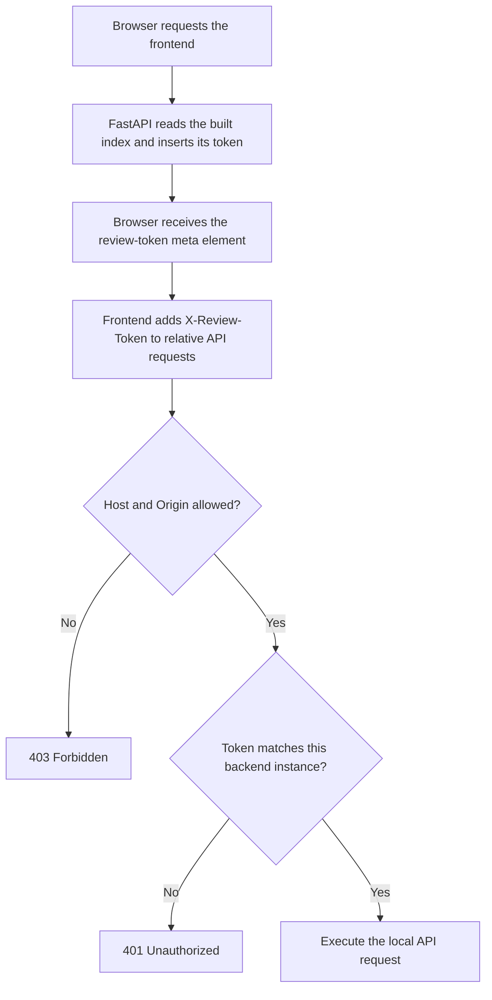

# Local API authentication

The loopback companion uses a per-launch token between its frontend and local API. The token is not a login and does not identify a person. An enrolled companion authenticates to the firm's protected service separately using an individual SSO token supplied to the Python process.

## Purpose

A port does not establish permission to access originals, upload files, or record review decisions.

An unrelated website open in the browser can attempt requests to localhost. Browser cross-origin restrictions block many interactions, but not every kind of request. The backend checks Host and Origin itself, then requires the frontend's token for API calls. The token is defense in depth if another boundary is missed or regresses. It is not a substitute for user authentication in a hosted application.

## Request flow

Relevant code:

- `src/review_api.py`: creates the token, checks request boundaries, and inserts the token into the built app entry.
- `review_ui/index.html`: contains the `review-token` meta placeholder.
- `review_ui/src/lib/api.ts`: reads the meta value, attaches `X-Review-Token`, and expires the frontend session after a 401.
- `review_ui/src/lib/session.ts` and `components/routing/SessionBoundary.tsx`: stop further API calls and replace the inactive UI with an explicit reload action.

The HTML response is intentionally available without a token so the local UI can initialize. It is subject to the loopback Host/Origin boundary and is not cacheable. API requests use the same origin and require the token; there is no separate frontend server or authentication bootstrap endpoint.

## Token lifetime and secrets

The backend generates a fresh random token when its application instance starts. It keeps that token in memory. The browser receives it in HTML and sends it in a request header, not in a URL. It is not stored in SQLite or configured in a frontend environment file.

After restarting the backend, refresh the frontend to obtain its new token. The launcher serves the compiled frontend and API from one origin using the configured data directory.

An older tab may keep sending the previous token, producing alternating successes and 401 responses. On 401 the frontend cancels the active stream and requests and offers **Reload workspace**. Reload obtains a current token; it does not replay mutations or prove that a native return was closed. Uncommitted files must be selected again.

After rebuilding the frontend, restart the backend and reopen its printed address to load current assets. Do not disable authentication, edit tokens, or change the database to fix a stale local browser session.

The evidence stream uses `fetch` with the same header and a separate opaque review-session ID header. It does not include document text or field values. The firm SSO token, provider credentials, and native tool permissions are not included in the evidence HTML, a URL, or an observer message.

## Limits

This protects a local API boundary; it does not authenticate individual staff members. A local program or person with access to the computer can request the public frontend and obtain the token. The check therefore does not protect against local malware, another untrusted OS user, browser compromise, or same-origin script injection.

Without firm enrollment, the launcher accepts uploads into a local inbox. `--inspect-archive` opens the historical SQLite archive read-only instead. Access depends on workstation isolation and OS file permissions. Neither storage mode is encrypted by the loopback token. Keep the backend bound to loopback and use a firm-approved protected workspace for sensitive documents.

## Content Security Policy

The app keeps `script-src 'self'` without `unsafe-eval`. Browser API schemas configure Zod with `jitless: true` before constructing object schemas; this disables its eval-based capability probe and runtime parser compilation without disabling validation.

The API regression checks the no-iframe policy; the Chromium regression exercises PDF and TXT rendering and file uploads under that policy. Do not add `unsafe-eval` to silence a dependency's capability probe.
