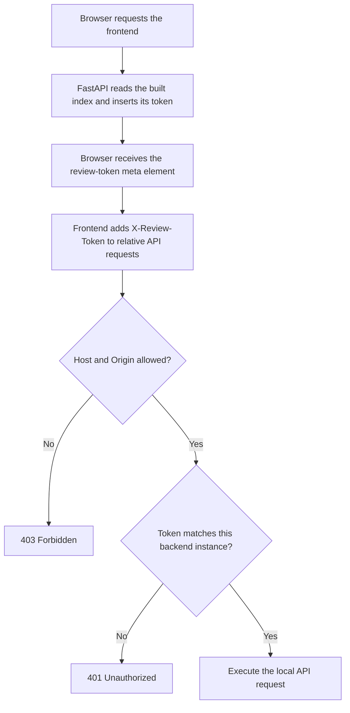

# Local API authentication

The companion has **no user login, accounts, passwords, or roles**. Its authentication check is an automatically handled, per-launch token between the frontend and the local Python API. It does not identify a person.

The app runs locally and serves the compiled frontend through FastAPI. It is not a public multi-user service.

## Purpose

A port tells a caller where to connect. It does not establish permission to read documents, change saved data, request external extraction, or control Playwright.

An unrelated website open in the browser can attempt requests to localhost. Browser cross-origin restrictions block many interactions, but not every kind of request. The backend checks Host and Origin itself, then requires the frontend's token for API calls. The token is defense in depth if another boundary is missed or regresses. It is not a substitute for user authentication in a hosted application.

## Request flow

Relevant code:

- `src/review_api.py`: creates the token, checks request boundaries, and inserts the token into the built app entry.
- `review_ui/index.html`: contains the `review-token` meta placeholder.
- `review_ui/src/lib/api.ts`: reads the meta value, attaches `X-Review-Token`, and expires the frontend session after a 401.
- `review_ui/src/lib/session.ts` and `components/routing/SessionBoundary.tsx`: stop further API calls and replace the inactive UI with an explicit reload action.

The HTML response is intentionally available without a token so the local UI can initialize. It is subject to the loopback Host/Origin boundary and is not cacheable. API requests use the same origin and require the token; there is no separate frontend server or authentication bootstrap endpoint.

## Token lifetime and secrets

The backend generates a fresh random token when its application instance starts. It keeps that token in memory. The browser receives it in HTML and sends it in a request header, not in a URL. It is not stored in SQLite or configured in a frontend environment file.

After restarting the backend, refresh the frontend to obtain its new token. The launcher serves the compiled frontend and API from one origin using the configured data directory.

An old tab can continue using the previous token while a newly opened tab uses the current token, producing alternating successful requests and 401 responses in the server log. Unauthorized uploads fail for the same reason; this is unrelated to the Gemini key.

On a 401, the frontend stops making API calls and unmounts the active workspace, cancelling its polling. It displays **Session expired — reload this page** and a **Reload workspace** button. Reloading obtains a current token; failed mutations are not automatically replayed. Saved documents remain on disk, but files that never uploaded must be selected again.

After restarting the server, reload or close every older workspace tab and open the address printed by the launcher. If the frontend was rebuilt, restart the backend first so its HTML references the current built assets. Do not disable authentication, edit tokens manually, change the database, or replace the Gemini key to resolve a stale local session.

`GEMINI_API_KEY` is a different credential. It stays server-side and is not included in the frontend HTML or sent to the intake website. Never place it in a frontend environment variable: frontend build tools can expose those values to browser code.

The independently controlled intake browser receives neither the companion token nor the Gemini key.

## Limits

This protects a local API boundary; it does not authenticate individual staff members. A local program or person with access to the computer can request the public frontend and obtain the token. The check therefore does not protect against local malware, another untrusted OS user, browser compromise, or same-origin script injection.

SQLite is not encrypted by this mechanism. Network deployment or multi-user access would require a separate access-control design, transport security, storage controls, and appropriate authorization. None of those features are implied by the current token check.

## Content Security Policy

The app keeps `script-src 'self'` without `unsafe-eval`. Browser API schemas configure Zod with `jitless: true` before constructing object schemas; this disables its eval-based capability probe and runtime parser compilation without disabling validation.

Browser regressions listen for `securitypolicyviolation` events while exercising native Chromium PDF/TXT drops, API validation, and PDF/text evidence rendering. Do not add `unsafe-eval` merely to silence a dependency's capability probe.
